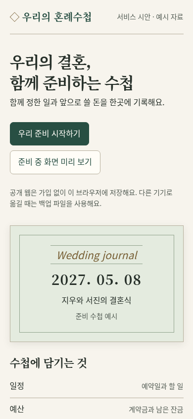
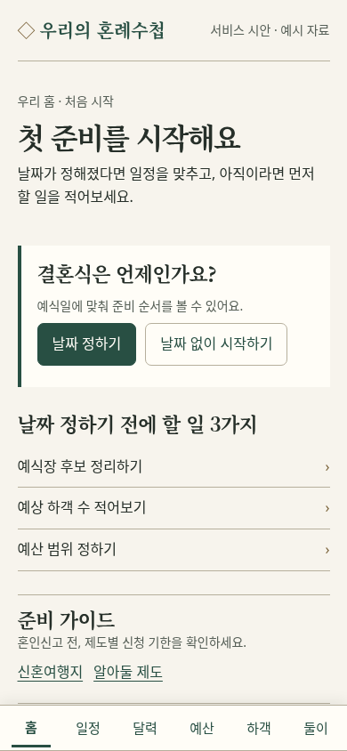
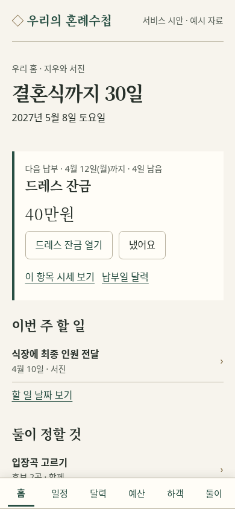

# 함께 쓰는 결혼 준비 수첩 · 제품 초안 2

예식일을 정했거나 계절만 정한 두 사람이 첫 할 일을 기록하고, 준비가 진행되면 다음 일정·납부·결정을 확인하는 서비스다. ‘우리의 혼례수첩’은 화면 검토용 가칭이다. 시안의 이름, 일정, 금액은 가상 예시다.

[화면 시안 파일](preview.html)을 내려받아 브라우저에서 열면 세 화면을 오갈 수 있다. GitHub에서는 아래 이미지를 선택해 확대할 수 있다.

| 공개 홈페이지 | 처음 쓰는 홈 | D-30 홈 |
| --- | --- | --- |
|  |  |  |
| 준비 시작 또는 예시 둘러보기 | 날짜 설정 또는 날짜 미정으로 첫 할 일 선택 | 다음 납부·이번 주 할 일·둘이 정할 안건에서 상세로 이동 |

## 메뉴 지도

공개 홈페이지 → 준비 시작 → 우리 홈. 재방문하면 우리 홈에서 이어간다. 공개 홈페이지에서 예시 수첩도 둘러볼 수 있다.

| 우리 공간 | 사용자가 하려는 일 | 현재 앱에서 이어올 화면 |
| --- | --- | --- |
| 홈 | 다음 할 일·납부·결정 열기 | D-day와 이번 주 현황. 홈에서 준비 가이드(신혼여행·알아둘 것), 공유와 백업에 접근 |
| 일정 | 목록으로 준비 순서 확인 | 진행 순서, 혼인신고 관련 제도 바로가기 |
| 달력 | 예약·납부일 조회 | 독립 진입점, 해당 날짜에서 원래 항목 열기 |
| 예산 | 계약 총액·예약금·잔금 확인, 두 견적 비교 | 예산과 가격 비교, 청첩장 모임 세부 내역 |
| 하객 | 양측 초대 명단과 참석·축의금 관리 | 하객 목록과 상세 |
| 둘이 | 대화 주제 열기, 결정 기록, 파트너 관리 | 둘이 정할 것, 환경별 공유·백업 안내. 담당자 배정은 신규 제안 |

## 첫 출시 범위와 검토 기준

- 모바일 웹에서 첫 방문과 재방문 흐름부터 검증한다. 데스크톱은 같은 메뉴 구조를 쓰고, 넓은 폭에서는 목록과 관련 상세를 함께 볼 수 있게 한다.
- 처음 온 사람이 예식일을 건너뛰고 첫 할 일을 찾는지, D-30 화면에서는 다음 납부액과 기한을 보고 해당 예산을 여는지 관찰한다. 세 번째 과제는 두 사람 중 누가 최종 인원을 전달할지 확인하는 것이다. 세 과제를 3~5쌍에게 안내 없이 시도해 본 뒤 첫 클릭과 막힌 지점을 기록한다.
- 공동 편집은 별도 출시 판단이 필요하다. 현재 공개 웹은 브라우저에 저장하고 Claude 아티팩트는 권한에 따라 공동 저장한다. 공개 웹에 초대를 도입하려면 상대의 참여 동의, 수정 권한, 연결 해제, 기존 개인 기록 이전을 먼저 설계한다. 가상 화면에서 저장·초대는 실행되지 않는다.
- 설치형 앱의 우선순위는 모바일 웹 반복 사용을 관찰한 뒤 정한다. 가격 자료의 월별 점검은 별도 운영 과제로 관리한다.

## Claude 리뷰 반영

[검토 원문](https://github.com/dudwlstjr3-maker/marry-me/pull/28#issuecomment-6966352465)

- 첫 방문에서 예시 수첩의 용도와 공개 웹의 저장 방식을 안내한다. 양쪽 홈에서 준비 가이드와 공유 안내를 열 수 있다. 예산의 첫 선택지는 ‘내 예산 / 가격 비교’이며 시안을 열어 둔 동안 마지막 선택을 기억한다.
- 예식일 미정이면 2027년의 계절 또는 ‘아직 몰라요’를 선택하고 날짜 전 준비 과제 세 가지로 이어간다. 계절의 첫날은 임시 기준이고 D-day를 확정하지 않는다.
- D-30 홈에서 잔금 기한·남은 일수를 읽고 ‘냈어요’를 누르거나 되돌릴 수 있다. 날짜에서 해당 항목으로 이동한다. 예시에는 기한이 지난 미납금이 없다. 실제 연체 건이 있을 때는 다음 납부 위에 우선 표시하는 것이 다음 단계다.
- Claude는 일정 속 달력 보기를 제안했다. 사용자가 요청한 독립 달력 진입점을 유지하는 안으로 모바일 하단에 여섯 메뉴를 두었다. 320px에서 44px 누름 영역과 한 줄 배치를 확인한다.
- 두 저장 환경의 공유 범위를 각각 설명한다. 견적서 읽기는 해당 권한이 있는 Claude 아티팩트 기능으로 안내한다.
